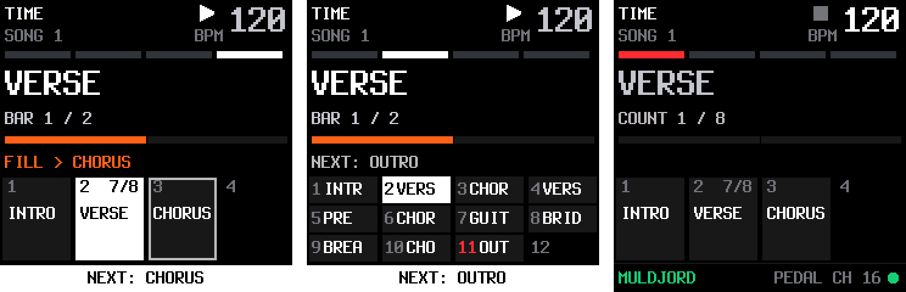
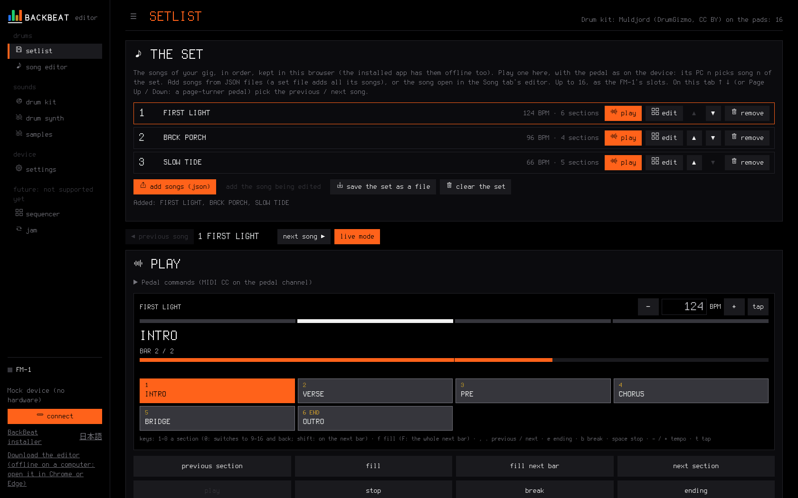
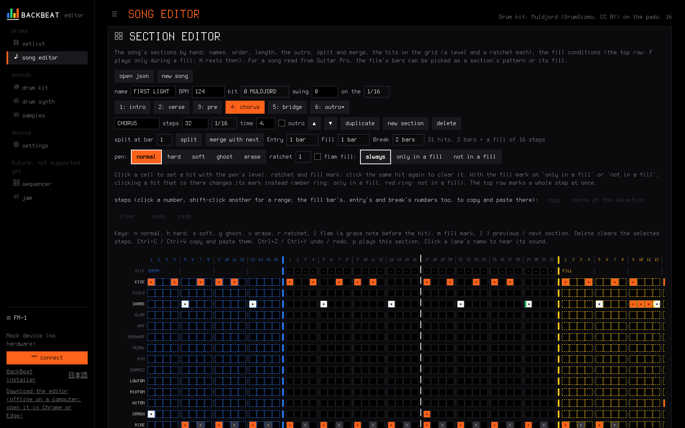
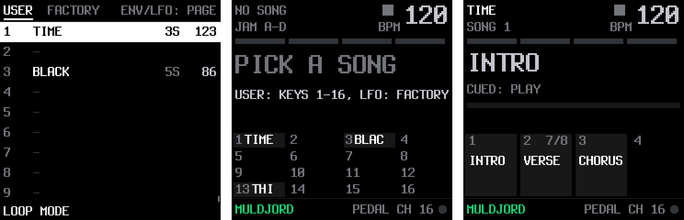
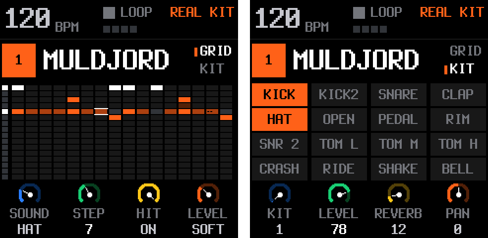
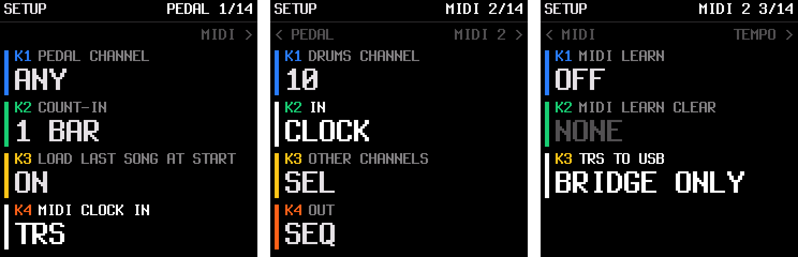

<p align="center"></p>

# BackBeat

**A pedal-cued drummer for guitarists, on the M-VAVE FM-1.**

BackBeat is a replacement firmware for the FM-1 that turns it into a drummer you lead from your
pedalboard. A song is a set of drum sections (intro, verse, chorus, bridge, solo, outro); you switch
between them live from your footswitches over the FM-1's TRS MIDI jack, with fills where you ask for
them. No backing tracks: how long each section lasts is decided on stage.

<p align="center"></p>

- **Songs from your pedal:** load a song, go to any section on the next bar line, ask for a fill, a
  break, the ending or a stop, tap the tempo, all with plain MIDI CC and PC messages.
- **A real kit on board:** MULDJORD, a layered acoustic kit (up to four velocity layers a drum,
  round-robin kicks and snares, twelve voices), plus a humanize setting so it never sounds quantized.
- **Songs from Guitar Pro or MIDI:** the web editor imports the drum track, finds the sections, and
  lets you fix them on a grid, hear them, and send them to one of 16 slots. 16 factory grooves to
  start with.
- **A screen you can read from the floor:** the section playing in large letters, the bar count,
  what comes next, the sections as tiles.
- **Works with a tablet:** the FM-1 can pass the pedal on over USB, so the editor's player on a
  tablet follows along as a big screen on the music stand.

**Status.** It runs on a real FM-1 and has been played live from a Hotone Ampero II Stage. It has
been tested on one unit so far, so treat it as early: back up your unit first
([docs/recovery.md](docs/recovery.md)), and [open an issue](https://github.com/ForrestPanda/backbeat/issues) to say how it went.

A fork of [SLOOP](https://github.com/isod89/sloop-fm1) 2.6 (GPL-3.0, itself from
[Felucca](https://github.com/hugelton/Felucca)), **drums only**: SLOOP's synth side (the synth engines and
presets, the sampled instruments, the punch FX, the SLICER, live recording, the arpeggiator, scales and chords,
three of its four tracks) is gone, see [docs/drums-only.md](docs/drums-only.md). What is left of SLOOP is its
drum track, sequencer and sections (SLOOP's own manual is upstream). What this fork adds is in
[docs/design.md](docs/design.md). The firmware reports itself as BACKBEAT 0.9 (the editor's INFO keeps its
`FELUCCA ` prefix, and the USB port names and the backup format stay SLOOP's, so the tools keep working).

## Getting started

**What you need.** An M-VAVE FM-1; a pedalboard or MIDI controller with a 3.5 mm TRS MIDI out (Type A, as the
FM-1's jack; the Hotone Ampero II Stage is the one it was built with, see [docs/ampero-setup.md](docs/ampero-setup.md))
or one that sends MIDI over USB; a plain stereo 3.5 mm cable; Chrome or Edge on a computer for the install.

**Before you install.** This is a replacement firmware, installed at your own risk. The FM-1 is hard to
brick (the installer never touches its boot code, and BackBeat has a rescue screen), and the way back to the
official firmware is the same installer with M-VAVE's FM-1 V15 file (m-vave.com, Downloads, PC Firmware).
[docs/recovery.md](docs/recovery.md) has a one-minute backup of your unit to take first (Linux), and every way back.

**Install.** Open the installer at <https://forrestpanda.github.io/backbeat/> in Chrome or Edge, plug in the
FM-1 and follow the page. The package is also on the
[releases page](https://github.com/ForrestPanda/backbeat/releases) and in [docs/firmware/](docs/firmware/), for
the command line (`python3 tools/fm1_install.py backbeat-0.9.fwsc`) or a local copy of the site
(`cd docs && python3 -m http.server 8000`, then `http://localhost:8000/webapp/installer/`). If BackBeat
stops starting after an install, hold **OCT-** alone while switching on: the BACKBEAT USB RESCUE screen
takes the package again.

**Play something.** BackBeat starts on its LIVE screen with sixteen factory grooves on board (the SONGS screen,
the pedal's PC 16..31). PLAY starts, SEL fills, ENV / LFO go to the previous / next section.

**Your songs.** Open the editor (<https://forrestpanda.github.io/backbeat/webapp/editor/>, or `webapp/editor/` on a local copy): its Song editor tab
imports a Guitar Pro or MIDI file, finds the sections, lets you fix them on a grid and play them; Send puts the
song in one of the FM-1's 16 slots.

**Your pedal.** Set it to send on channel 16. The five messages that cover a gig:

| Switch | Sends | Does |
| --- | --- | --- |
| a section | CC 20, value 0..15 | that section when the one playing reaches its end (stopped: starts with it) |
| fill | CC 21 | a fill; sent with a section's CC 20, the fill leads into it |
| ending | CC 22, value 127 | the song's outro, then stop (no outro: the section ends, then stop) |
| stop | CC 23 | stop now |
| a song | PC 0..15 | load song 1..16 |

Everything else (breaks, next / previous, tap tempo, entries, the count-in) is in the full table below.

**Known limits.** No MIDI out: the FM-1 has no MIDI out jack. JAM, on the SONGS screen, is SLOOP's own A..D
sections, left as SLOOP had it and not supported. How much of its time the audio takes on your unit is on SETUP > LOAD (the
average, the worst block since OCT+, blocks rendered too late, which you would hear as a click, and the drum voices):
play your busiest song, then look.

## The pedal

Footswitches send MIDI on channel 16 (default) to the TRS jack or over USB:

| Message | Meaning |
| --- | --- |
| CC 20, value 0..15 | section 1..16 of the song (no song loaded: 0..3, SLOOP's A..D) when the section playing has played its pattern out (a 1-bar section: the next bar; a fill pending: the bar after it), no fill of its own; stopped: start with it. The section already playing: nothing. A section with an entry comes in through it (below) |
| CC 27, value 0..15 | that section on the next bar, without waiting for the section's end, no fill of its own |
| CC 21 | the fill. A section with a fill bar of its own, as an arranger's fill-in: the rest of this bar (pressed in its last beat: the whole next bar), then the pattern from its top. A fill of several bars (up to 4, the section editor's Fill select) ends on the section's last bar line: asked earlier, it waits (the screen says FILL AT THE END), then plays whole; asked with fewer bars left, its last bars from now. A section without one: fill mode to the section's end, its fill marks heard where they sit, the pattern on with no restart (nothing marked: nothing changes). Sent with a CC 20 / 22 / 24 / 25 / 27 (either order), the fill into that change, which lands on the bar after the fill. Value 1: the whole next bar from anywhere in this one, for a fill that leads off its bar |
| CC 22, value 0..15 | ending: the section playing ends, that section once as the outro, stop on the bar (other values: the song's flagged outro, or the section ends, then stop; the outro playing already: it plays to its end, then stop) |
| CC 28, value n | the break: section n through its break, when the section playing ends (as CC 20; with CC 21 on the switch: the fill, then the break); the section playing too. Value 127 (not a section): the section playing's, so one switch serves every song. No break written: its entry; neither: a bar of rest. Stopped: start with it |
| CC 23 | stop now |
| CC 24 / CC 25 | next / previous section (empty ones skipped, wrapping), as CC 20; stopped: the first / the last |
| CC 26 | tap tempo (on the device: the last black key, F#5, on LIVE) |
| PC 0..15 | load your song in slot 1..16: stopped, its tempo and kit now and its first section cued; playing, with the next section |
| PC 16..31 | load factory groove 1..16 (the same way) |
| PC 32..127 | no song: SLOOP's sections A..D again |

**Count-in.** A setting kept with the pedal channel (off by default): a section pressed while stopped first
clicks one or two bars at the song's tempo (the metronome's voice, the first beat of each bar accented), then
the loop starts with that section. CC 23 cancels it; another section pressed meanwhile only changes what starts.
`python3 tools/fm1_song.py --count-in 1`, the Song editor tab's pedal row, or SETUP > PEDAL on the device; hear it with
`fm1_render.py --count-in 1`.

**Entries and breaks.** A section can carry an entry and a break: one to four bars (64 steps), silence too, played
before its pattern as it comes in; after them the pattern starts from its top, and a section pressed meanwhile comes in
at their end (Shine On's 4 bars between two 3-bar phrases: the next section on the 5th bar, not the 4th). The entry
plays when the section comes in from another section or from stopped; pressing the section already playing still does
nothing, so a switch with a fill and its own section plays just the fill. The break plays on CC 28, at the end of
the section playing (as CC 20). A fill pressed during one cuts it; CC 21 value 1 in its last bar (or a plain CC 21
in its last beat) lets it play out and fills the bar after it. In the JSON
`"entry": {"bars": 4, "lanes": {...}}` and `"break": {"lanes": {}}` (a silent bar); in the editor, the section's
Entry and Break selects and their blue columns, or **Entry / Break = selected bars** from a Guitar Pro file;
`fm1_render.py --play "VERSE:4, !VERSE:4"` plays a section through its break.

**Songs.** A song is up to 16 named drum sections (intro, verse, chorus, bridge, solo, outro...) with its
tempo, kit and swing (`"swing"`: 0 straight, the default, up to 100, MPC's 50 to 75 %; every second step of a 1/4,
1/8, 1/16 or 1/32 grid comes late; `"swing_grid": "1/8"` moves the 8ths instead, the 16ths inside each sharing them:
a shuffle for a 1/16 pattern with its hats on the 8ths, which a swing on the 16ths would leave straight; the importer
sets it from a Guitar Pro triplet feel, with swing 67, two to one); 16 songs live in flash. The screens (the device and the editor) number
them 1..16; the pedal's PC and `fm1_song.py --put` count from 0 (song 1 is PC 0, `--put 0`). Sections the same:
the screens show 1..16, the value of CC 20 / 27 / 22 counts from 0 (section 1 is CC 20 value 0). Each section has a time signature (`"time"`, 4/4 if left out) and is
a whole number of its bars: the FM-1 counts bars, so a change waits for the bar line. A pickup or a short intro is a
short bar (4 steps of 1/16 is `"time": "1/4"`); `fm1_song.py` and the editor's section editor flag a section that
is not whole bars and offer the signature that fits. Write one as JSON (`tests/example-song.json` is the model; `song_examples/` has three demo songs, docs/demos.md) and send it over USB:

```
python3 tools/fm1_song.py tests/example-song.json            # check it
python3 tools/fm1_song.py tests/example-song.json --put 0    # into song slot 0 (the FM-1 stopped)
python3 tools/fm1_song.py --pedal-channel 16            # the pedal's MIDI channel, kept through power-off
python3 tools/fm1_song.py --count-in 1                  # one bar of clicks before a start from stopped (0, 1, 2)
```

Its **Setlist** tab keeps the songs of a gig in the browser (offline in the installed app) and plays them there with
the real pedal (PC n picks song n of the set), with a **live mode** for a tablet on a music stand (full screen, big
section tiles, the screen kept awake); with the FM-1 connected it sends the set to the device's slots.

The site works on a **desktop or laptop, a tablet and a phone**: the side bar beside the page above 860 px, a top
bar under it, and a phone layout at 600 px and under where live mode fits one screen (the song, the LIVE view, the
pedal's rows) and the section editor's grid scrolls sideways under fixed lane names; checked on a 1080 x 2400
phone and a tablet. Chrome or Edge for the FM-1 over Web MIDI, and for the pedal over Bluetooth (Web Bluetooth, BLE MIDI);
the installed app works offline, on Android too.

Or open the web editor (`web/editor.html`): its **Song** tab works without an FM-1 (the import, the section
editor and the player below); with the FM-1 connected by USB it also lists
the sixteen slots, takes a song JSON by drop or file picker, saves one back as JSON, erases a slot, and sets
the pedal's MIDI channel. Its **From Guitar Pro, MIDI or JSON** card runs `tools/gp2song.py` itself in the browser (Python
through Pyodide, loaded from the internet the first time; PyGuitarPro fetched for Guitar Pro files only) on a
Guitar Pro file or a MIDI file, or opens a song JSON as it is (one saved from the
editor, or from `song_examples/`); a file dropped on that card or on the editor opens too. Its **Play** card plays a song
with the kit's pads as the pedal would, on a view of the device's LIVE screen (the beat lights in the section's
time signature, the section with its bar and a progress ticked per bar, the count-in, what comes next, the sections
as tiles, all in time with what you hear): the tiles are the footswitches, with fills, the ending, stop, the song's
swing and the count-in as the device has them; keys (shown under the tiles): 1..8 a section (0 switches them to 9..16 and back), shift + the key on the next
bar, f a fill (F: the whole next bar), comma and period previous / next, e the ending, space stop; **MIDI in from** and **Listen to the pedal** let the real pedal (the
Ampero, or a USB MIDI interface between it and the computer, or the FM-1 itself with SETUP > MIDI 2 > TRS TO USB on:
what its TRS jack receives, over its USB: "A tablet beside the FM-1" below) drive that player with the same CCs and PCs as the
FM-1, on the Pedal card's channel (PC n opens song n of the FM-1 connected, or of the simulated one), so the
live workflow can be rehearsed before the hardware; **Follow its MIDI clock** makes the player take that input's
tempo and START / STOP, as the FM-1 does with SETUP > PEDAL > MIDI CLOCK IN; **Connect Bluetooth** takes the pedal over BLE MIDI instead
(a Bluetooth MIDI pedal or interface), so a phone
with nothing installed can be the player: Chrome or Edge on Android, Windows or macOS, from https or
localhost (Chrome on Linux keeps Web Bluetooth behind a flag; Firefox and Safari on the iPhone have none). Its **Section editor** card edits a song by hand: names, order,
length (at most 64 steps, 4 bars at 1/16: a section is a groove that repeats, `docs/design.md` says why), the time signature, the outro, split and merge, the hits on a grid with levels, ratchets, flams (a grace note
before the hit) and fill marks, the fill
conditions, columns copied and pasted, undo and redo (Ctrl+Z / Ctrl+Y), keys for the pen (n h s g x, r for the
ratchet, l for the flam, m for the mark, [ ] between sections), a lane's sound on a click of its name, "Play this section" to
loop it, and, for a song read from Guitar Pro, the file's bars to pick as a section's pattern or its fill (with a song
already in the editor, a Guitar Pro or MIDI file brings only its bars, and a song JSON opened keeps them: work from a
saved JSON and the file side by side, "keep the song in the editor" on the import card); then
Play, Send or Save JSON. The
Drum kit page opens with the Muldjord Kit on its pads (served from `web/kit/`, CC BY 4.0, see `docs/kits.md`), and
the player plays the device's layered kit MULDJORD (`web/realkit/`, its layers and takes as the device picks them),
or those pads once you edit them, or WAVs you pick. The page must be served, not opened as a file: from the project
root `python3 -m http.server 8000`, then `http://localhost:8000/web/editor.html?mock=1` for the simulated
FM-1 (serving `web/` itself works too: the importer is linked there).

**Latency.** Played from the pedal, the browser's player answers noticeably later than the FM-1: in the author's
tests its latency is quite high. It is fine for building songs, trying BackBeat out and rehearsing; on stage, play
the drums from the FM-1 (a tablet beside it can still show the LIVE view, below).

<p align="center"></p>

<p align="center"></p>

Or take the drum track of a Guitar Pro file (.gp3 / .gp4 / .gp5; `pip install pyguitarpro`) or of a MIDI file
(.mid, type 0 or 1, nothing to install: channel 10 is the drums, the marker meta events the sections, the time
signatures the bars, the first set-tempo the tempo): the section markers become the sections, each with the
pattern its bars repeat and the bar that deviates as the fill; a file without markers gets its sections from the
drums alone; edit the JSON afterwards:

```
python3 tools/gp2song.py "song.gp4" --out song.json
python3 tools/gp2song.py "song.mid" --out song.json
```

**In practice** (the author's workflow): the sections the importer finds, from the file's markers or from the drums
alone, are a draft, not a finished song. Import the Guitar Pro or MIDI file in the editor, open the same file in
TuxGuitar beside it, and fix the sections against the score: where each one starts and ends, which bar is its fill,
the outro. Pick the bars in the section editor's strip, play the result on the Play card, then send it to a slot.

Then PC 0 from the pedal loads it and CC 20 picks its sections (0 = the first). Hear it on the computer
first, played by the pedal through the firmware's own drum engine (after a `./build.sh`):

```
python3 tools/fm1_render.py tests/example-song.json --play "INTRO:2 VERSE:8 CHORUS:8 SOLO:8 OUTRO" --listen
```

Or see the device itself on the [fm1-emu](https://github.com/joakimeriksson/fm1-emu) emulator (built with
`cargo build --release -p fm1-emu`; `--emu PATH` points at its batch runner): your songs imported into its flash (as `fm1_song.py --put` would put them on a device), the firmware
run with a script of keys, knobs and pedal messages into the TRS jack, the screen saved at the times you ask
(`build/emu/lcd_<ms>.png`) and the sound with `--wav`. The emulator runs about 30 times slower than the device
on a PC. (With songs given, a song saved on the device in that run does not read back: the emulator shows the
flash image as loaded; with no songs given your slots are empty and it plays the factory grooves, which are read-only.)

```
python3 tools/fm1_emu.py                                                             # the demo on the factory grooves
python3 tools/fm1_emu.py song_examples/first-light.json my.json --wav build/emu/run.wav   # songs in slots 1 and 2
```

**Factory grooves.** The firmware carries the sixteen grooves of `grooves/` (`tools/gen_songs.py`, in the order of
`grooves/factory.txt`; `docs/grooves.md` describes each) as a bank of their own, apart from your 16 slots: the SONGS
screen's FACTORY page, the pedal's PC 16..31. They are read-only and always there, so a fresh device or the emulator
has something to play at once, and sending your songs never overwrites them. Your songs go in the USER slots: from the
web editor's Setlist tab (one slot, or the whole set: song n in slot n, the slots after it erased) or with
`fm1_song.py --put`. The Setlist tab lists the grooves too (they come with the site, so no FM-1 is needed): play one, open
it in the editor, or add it to the set to make it a song of your own.

**A sampled kit of your own.** A folder of WAV files (any CC0 kit; `assets/samples-cc0/KIT` is one)
becomes the device's kit USR3+4: the files are sorted onto the 16 lanes by name, trimmed, cut to the
slots' 2 x 7.4 s and levelled:

```
python3 tools/mkkit.py ROCK path/to/wavs --image build/host/rock.img     # hear it: fm1_render.py --usrkit build/host/rock.img
python3 tools/mkkit.py ROCK path/to/wavs --load                           # into the FM-1 (USR3 and USR4)
```

An SFZ kit with velocity layers works too (`--sfz kit.sfz`: the hardest layer of each drum, FLAC decoded
with sox; `--layers` adds a soft layer for ghost and soft hits, `--hires HAT,PEDAL,RIM` keeps the bright short
sounds at 44.1 kHz); `docs/kits.md` has the kits tried, the chosen one (the Muldjord Kit, CC BY 4.0) and the recipes.
Songs then use that kit by its index (`"kit": 41` in the JSON, the kit after the built-in and SYN kits).
The songs live in the flash of the USR1 and USR2 sample slots (8 songs each, two safe copies of every song), which
the drummer gives up: the kit pair USR3+4 stays yours. With no song loaded the
pedal plays SLOOP's own sections A..D (the four project slots). **Fills** are marks on the hits of a section's
pattern: a hit marked "only in a fill" plays only during a fill (CC 21, a black key or SEL on the LIVE screen),
one marked "not in a fill" rests then, mark by mark in the editor's grid or lane by lane in the JSON (`"fills"`);
SLOOP's own whole-step conditions still work on top. Built for the Hotone Ampero II Stage (each footswitch sends up to three CC / PC messages), but any
pedalboard with a MIDI out does. With the Ampero as the MIDI clock master (CLOCK OUT(TRS) on, the FM-1's SETUP > PEDAL >
MIDI CLOCK IN on TRS) the drums play at the patch's tempo, and the Ampero's **looper stays in time with the drums**
(`docs/ampero-setup.md`).

## A tablet beside the FM-1

The editor's player can follow the pedal along with the FM-1 on a tablet or phone: its LIVE view a big screen on the
music stand, or its sound the drums. The FM-1 passes the pedal on over its own USB cable, so the tablet needs no MIDI
interface (verified on the first unit, 2026-10-22, with the Ampero II Stage and an Android tablet).

1. On the FM-1, **SETUP > MIDI 2 > TRS TO USB** (KNOB 3; kept through power-off):
   - **ON**: the FM-1 plays as always, and what its TRS jack receives (the footswitches' CCs and PCs, the MIDI clock)
     goes out over USB as well.
   - **BRIDGE ONLY**: it goes out over USB and nowhere else; the FM-1 plays nothing from the pedal (no section, song,
     fill, stop or clock), a plain TRS-to-USB MIDI interface. LIVE says **BRIDGE: PEDAL TO USB**; the FM-1's own keys
     still work (PLAY stops a song that was playing when you switched).
   - **OFF** (the default): nothing goes out.
2. The tablet on the FM-1's USB (an OTG cable on Android; the tablet powers the FM-1), the editor open in Chrome or Edge.
3. On the Play card: **MIDI in from** = **FM-1: its TRS jack**, **Listen to the pedal**, and **Follow its MIDI clock**
   when the pedalboard sends one (the Ampero: Global > MIDI > CLOCK OUT(TRS) on), so the player keeps the FM-1's tempo.
4. **Screen ahead** (ms, on the Play card, 50 by default, kept on the tablet): a screen shows a frame some tens of
   milliseconds after it is drawn, so the LIVE view runs that much ahead of the sound; set it by eye until the beat
   lights move with the FM-1.

With ON, both play: turn the tablet down for a screen only, or use BRIDGE ONLY to make the tablet the drummer. Measured on
the tablet: the FM-1 to the page in about 2 ms, the clock steady (within 1.5 ms), the player locked to it within about
1 ms; the tablet's own audio delay is accounted for. SysEx and song position are not passed on (the editor's own SysEx
shares the cable).

## On the device

Four screens, a button each. Every one of them was checked on the fm1-emu emulator and in the host tests; LIVE
has been played from the pedal on an FM-1 (2026-10-19).

| Button | Tapped | Held |
| --- | --- | --- |
| HOME | **LIVE**, the screen it starts on | |
| SAVE | **SONGS** (from SONGS: LIVE again) | on EDIT: the section into its song; elsewhere SLOOP's section layer (A..D) |
| SEQ | **EDIT**, the drum grid of the section playing (again: GRID / KIT) | the step layer, as SLOOP |
| GLO | **SETUP** (again, HOME or OCT-: closed) | |
| SEL / ENV / LFO | on LIVE: **FILL**, **PREV**, **NEXT** (the pedal's CC 21, 25, 24; PREV / NEXT without a fill) | |
| PLAY | start the section cued (the count-in first), or stop | |
| FX, EDIT, ARP | FX: the filter, insert, delay and reverb pages | SLOOP's layers (throws, erase / mute / undo, roll) |

**LIVE.** What plays, readable from the floor: the song and its slot, the tempo, the beat lights in the bar's
meter; the section in large letters with "BAR 3 / 8" and a progress ticked per bar ("COUNT 2 / 8" during the
count-in); what comes next, in colour (NEXT: CHORUS, FILL, FILL NEXT BAR, FILL > CHORUS for a fill into a change,
ENDING); the song's sections as tiles, four to a row as the white keys 1..16, as many rows as the song needs (up
to 4 sections the whole names, up to 8 a name each, 9..16 a line each: the number and the name cut; the one
playing lit, the one cued framed and blinking, the outro and any meter but 4/4 marked); and a footer with the kit, the pedal channel and a dot that lights when the pedal sends. The pedal's
messages ("SONG: BLACK", "NEXT: SOLO") show in the footer. The white keys 1..16 change section when the one
playing ends, with OCT+ held on the next bar (the state line says KEY: ON THE NEXT BAR), with no fill of their own; the first black key (F#3) asks for a fill (as CC 21:
the rest of the bar with a fill bar of its own, else to the section's end; with OCT+ held the whole next bar), the second (G#3) the fill on the whole next bar,
the fourth (C#4) the break (as CC 28: the section playing comes in again through its break when it ends); the last (F#5) the
**tap tempo** (as CC 26, song loaded or not), its light flashing the tempo (with PLAY while playing; stopped, at the
tempo, so a tap or a MIDI clock shows at once); the other black keys as the first. So a plain change is one press, and a fill into the change is a black key then a white one,
as the pedal's CC 21 sent with its CC 20. SEL is a fill too, ENV and LFO the previous and next section
(without a fill). KNOB 1 (and SELECT) the tempo, KNOB 2 (and PRESETS) the kit, KNOB 3 the drums' level, KNOB 4 the
swing. With no song loaded it says PICK A SONG and shows the 16 songs of the SONGS page shown (USER or FACTORY;
ENV / LFO switch), and the white keys 1..16 load them.

**SONGS.** Two pages, as tabs in the header: **USER**, your 16 slots, and **FACTORY**, the 16 grooves (read-only). ENV
shows USER, LFO FACTORY (the header's "env/lfo: page"; "rec: load" at the bottom). It opens on the loaded song's page; with no song, on USER, or on FACTORY while your slots are
all empty. Each page lists 16 songs (9 rows at a time, the list scrolling with the row picked) with their name, tempo
and number of sections, and a last row JAM: SECTIONS A..D, SLOOP's four sections and their chain editor. KNOB 1 or
SELECT picks a row, REC or OCT+ loads it and goes back to LIVE; a white key 1..16 loads that song of the page at once.
The LIVE header names the song's bank: "song 3" or "factory 3". EDIT's SAVE held on a groove says FACTORY: READ-ONLY
(to change one, add it to the set in the web editor, edit it there and send it to a slot).

<p align="center"></p>

**EDIT.** SLOOP's drum grid and kit page for the section playing; its header names the section and, stopped,
the song. Change hits, levels and ratchets as SLOOP does, then hold SAVE (stopped): a ring fills for a second and
the section is written back into its song in flash ("SAVED INTO THE SONG"; "SONG FULL" past 3800 bytes; nudges and
parameter locks are not kept, SNG2 has no room for them, and the screen says so). With no song loaded SAVE held
saves the project slot, as SLOOP did. A tap of SAVE opens SONGS.

<p align="center"></p>

**SETUP.** SLOOP's menu, its GLO pages and its mix layer in one place, a section at a time (SELECT), up to four
rows each on KNOB 1..4 (PRESETS moves the cursor, OCT+ acts): PEDAL (channel, count-in, load the last song at
start, MIDI clock in: OFF, USB or TRS, the tempo and START / STOP from a clock master such as the Ampero), MIDI (the
drums' channel, IN, other channels, OUT), MIDI 2 (MIDI LEARN, clear; TRS TO USB: what the TRS jack receives goes out
over USB as well, the pedal and the clock for a tablet's editor to follow; off by default; BRIDGE ONLY: out over USB
and nothing else, the FM-1 a TRS-to-USB MIDI interface that plays nothing, LIVE says BRIDGE: PEDAL TO USB), TEMPO (tempo, click,
tune), FEEL (swing, humanize), DRUMS (level, reverb, delay, pan), MASTER, TEXTURE and TEXTURE 2, SCREEN (colour, zoom; SCREEN OFF: NEVER, 1, 5 or 15 minutes stopped and untouched, then
the screen and its backlight go dark; a button, key, knob or the pedal wakes it, and the press that wakes it does
nothing else), LIGHTS, AUDIO,
LOAD (the audio's load and the drum voices), SYSTEM (calibration, the JAM project pages, ABOUT). The pedal settings are saved once the music stops.

<p align="center"></p>

**Humanize** (SETUP > FEEL: OFF, LIGHT, MORE; LIGHT out of the box): the sequencer plays each step a little early
or late (LIGHT up to 3 ms, MORE 6 ms; all the drums of a step together, so no flams) and each hit a little louder or
softer (up to about 1 and 2 dB), as a drummer does. The level moves after the hit's sample is picked, so an accent
or a soft hit keeps its own sound. It varies from bar to bar but is the same every time the song plays, so a render
is repeatable. The web editor's player does the same (its Humanize menu), and `tools/fm1_render.py --humanize`.

What else is on it, from SLOOP: one track, the drums (the kits: the
synthesised kits, SYN1..SYN4 from the editor's Drum synth, your own sampled kits on the user slots; and this fork's
MULDJORD), a pattern of
up to 64 steps over 16 lanes with levels, ratchets, nudges, parameter locks and fill conditions, rolls, erase and
mutes; sections A..D, their quick chain and SLOOP's song order; the drum track's INSERT and FILTER, the delay and
reverb sends, the master (DUST, DUCK, the DJ filter, the limiter), TEXTURE; MIDI in, out, clock and learn. The web
editor (protocol v11) edits the pattern, the kits, the drum synth, the samples, projects, songs and settings. (Gone
from SLOOP's screens: TRACKS, the visualiser, the GLO pages and layer, the HOME-held menu.)

## Build and test

```
./build.sh                   # build/felucca.bin, build/felucca.fwsc (toolchain and SDK: BUILDING.md)
sh tests/run_tests.sh        # the host tests (SOAK_MIN=1 for a short soak)
```

The TRS MIDI input is SLOOP's (`FELUCCA_UART=1`, in use since SLOOP 2.3). Install it as any Felucca
firmware ([BUILDING.md](BUILDING.md)): at your own risk.

## Layout

| Path | What |
| --- | --- |
| `docs/design.md` | the model, the pedal command map, milestones, flash budget, review notes, open questions |
| `docs/drums-only.md` | how SLOOP's synth side was taken out, stage by stage, and what each stage kept |
| `docs/recovery.md`, `tools/fm1_recover.py`, `tools/fm1_flash.sh` | installing safely: a backup of the unit first, the rescue screen, the ROM's download mode, the way back to stock |
| `docs/ampero-setup.md` | what to put into the Ampero II Stage's footswitches, the cable, what to check with the FM-1 |
| `docs/kits.md` | the drum kits: the chosen Muldjord Kit (CC BY 4.0, with Black Pearl's hats and Red Zeppelin's ride), the others tried, the recipes, the slot budget |
| `firmware/src/pedal.c` | the pedal: CC / PC from the MIDI in queue to section, song and transport requests |
| `firmware/src/sng.c` | songs: the packed form ("SNG2": a byte a hit, a meter per section), read in place from flash, a section into the drum track on the bar, the pedal settings |
| `firmware/src/ui_drummer.c` | LIVE and SONGS (on SLOOP's SONG page): the song playing, its sections, the keys as the pedal; the song list |
| `firmware/src/ui_menu.c` | SETUP: the pedal, MIDI, tempo, drums, master, texture, screen and system settings |
| `firmware/src/ui_studio.c`, `ui_input.c` | EDIT (SLOOP's drum grid and kit pages); the buttons, the layers and SAVE's hold on the grid |
| `tools/fm1_emu.py` | the firmware on the fm1-emu emulator, songs imported into its flash: a script of keys, knobs and pedal MIDI, screens and sound saved |
| `tools/fm1_song.py`, `song_examples/` | songs from JSON: check, pack, send, read back; `song_examples/` holds three original demo songs that show the features, each with its pedal plan in `docs/demos.md` (the factory songs are the grooves) |
| `grooves/`, `docs/grooves.md` | generic grooves, not songs (two sections, verse and chorus, 4-bar phrases, a fill at each phrase's end; each one's tempo, meter, verse, chorus and fill in `docs/grooves.md`): classic rock, blues, rock ballad, slow rock, punk, half-time shuffle, train beat, one drop, four on the floor, metal gallop, a 6/8 ballad, and some to spark ideas (7/8, a tom groove, linear funk, three over four, ride and kick only); the firmware's factory songs, slots 1..16 in `grooves/factory.txt`'s order |
| `web/editor.html` | the web editor (SLOOP's, drums only, protocol v11) with a Song editor tab (no FM-1 needed but to send and set the pedal): the pedal channel, Guitar Pro and MIDI file import (Pyodide), the section editor, a player; a Setlist tab: the device's sixteen slots; `web/test_web.mjs` tests it against the simulated FM-1 |
| `web/kit/` | the kit the editor serves (the Muldjord Kit with two velocity layers), the files `tools/mkkit.py` makes the device image from |
| `tools/gen_realkit.py`, `tools/realkit.json`, `assets/realkit/` | the built-in layered kit MULDJORD: the recipe, rendered once from the source kits into WAVs (layers, takes, levels, fitted to 290 KB); `tools/gen_samples.py` builds them in as set REAL, the editor's player plays them (`web/realkit/`) |
| `tools/fm1_render.py`, `tests/song_render.c` | a song played by the pedal, rendered to a WAV on the host |
| `tools/gen_screens.py`, `assets/screens/` | the screen pictures in this README, from the host tests' renders of every screen (`build/host/*.ppm`) |
| `tools/gp2song.py`, `tests/gp2song_test.py`, `tests/midi2song_test.py` | the drum track of a Guitar Pro file or a MIDI file into a song (markers, patterns, fills, levels, ratchets, flams); the MIDI reader is its own, the tests write their files |
| `tools/mkkit.py` | a sampled kit from a folder of WAVs or an SFZ kit onto USR3+4: lanes by name, two velocity layers, trim, cut, level; an image for the renderer, or the upload |
| `firmware/src/seq.c` | SLOOP's sequencer; the pedal hooks in its MIDI loop and `events_block` |
| `tests/pedal_test.c` | the pedal through the real sequencer: sections on the bar, fills, endings, next / previous, stop, tap |
| `tests/song_test.c` | songs through the real sequencer: the packed form's checks, PC, sections, the outro, back to A..D, a section packed again from the drum track (EDIT's save) |
| `tests/ui_pages_test.c` | the device's UI on a framebuffer: LIVE, SONGS, EDIT, SETUP, the layers, renders of every screen |
| everything else | SLOOP 2.6's drum side as forked |

## Licence

GPL-3.0-only, as SLOOP (see [LICENSE](LICENSE) and [LICENSING.md](LICENSING.md) for the assets).
M-VAVE and FM-1 are trademarks of their owners; this project is not affiliated with M-VAVE or Hotone.
